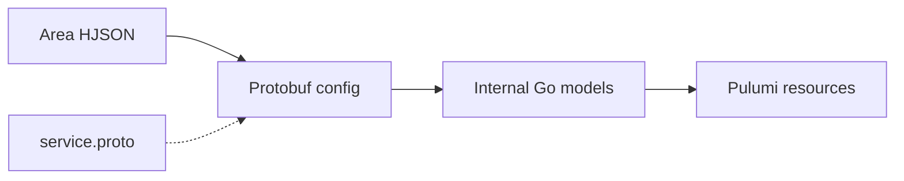
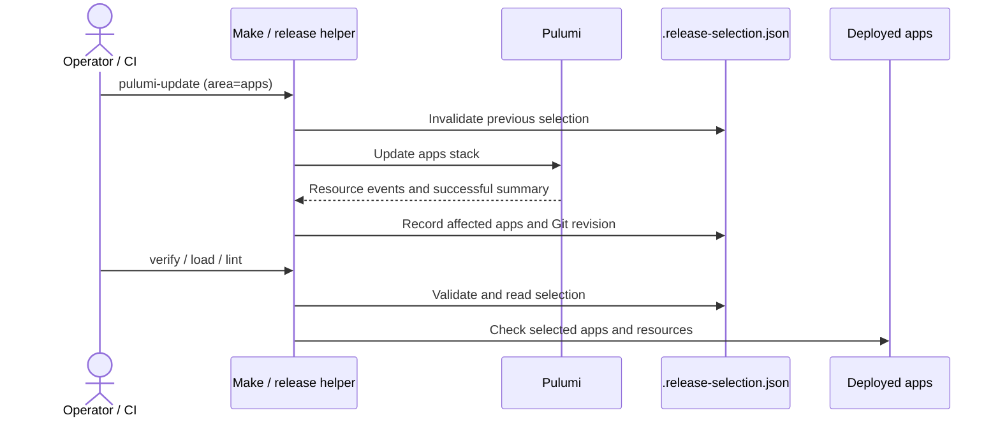

[](https://www.digitalocean.com/?refcode=b80d3d6467e1&utm_campaign=Referral_Invite&utm_medium=Referral_Program&utm_source=badge)

[](https://circleci.com/gh/alexfalkowski/infraops)
[](https://codecov.io/gh/alexfalkowski/infraops)
[](https://goreportcard.com/report/github.com/alexfalkowski/infraops/v2)
[](https://pkg.go.dev/github.com/alexfalkowski/infraops/v2)
[](https://masterminds.github.io/stability/active.html)

# 🧭 InfraOps

Infrastructure configuration and deployment for personal services, built with Go and Pulumi.
Operators manage Kubernetes applications, Cloudflare, DigitalOcean, and GitHub from this repository.
For application features, runtime settings, and usage, see each application's own README.

## 🗺️ Overview

| Area | Manages | Configuration |
| ---- | ------- | ------------- |
| `apps` | Kubernetes application resources | [apps.hjson](area/apps/apps.hjson) |
| `cf` | Cloudflare zones, DNS, and R2 buckets | [cf.hjson](area/cf/cf.hjson) |
| `do` | DigitalOcean VPC and Kubernetes cluster | [do.hjson](area/do/do.hjson) |
| `gh` | GitHub repositories, settings, and branch protection | [gh.hjson](area/gh/gh.hjson) |
| `k8s` | Cluster add-ons installed manually with Helm and kubectl | [Makefile](area/k8s/Makefile), [nginx values](area/k8s/nginx/values.yaml) |

Each Pulumi area has its own `main.go`, `Pulumi.yaml`, and HJSON configuration under `area/<name>/`.
Shared resource logic lives in `internal/`.



The [protobuf schema](api/infraops/v2/service.proto) owns field definitions, defaults, and deployment
conventions. The top-level HJSON `version` identifies the configuration schema. Semantic errors may
still surface during Pulumi or provider operations.

## 🚚 Bootstrap

Install Go at the version declared in [go.mod](go.mod), Make, and Ruby for the shared help/build helpers.
Initialize the `bin` tooling submodule, then download, tidy, and vendor dependencies:

```bash
git submodule sync
git submodule update --init
make dep
make help
```

Run `make dep` before local validation. Use `make help` for the command catalog and the
[CircleCI configuration](.circleci/continue_config.yml) for validation requirements. Go checks use
`betteralign`, `golangci-lint`, `gotestsum`, `govulncheck`, and Trivy; shell checks use ShellCheck;
API checks use Buf. The golangci-lint wrapper skips its check when the tool is absent from `PATH`.

When changing [service.proto](api/infraops/v2/service.proto), run `make api-generate` and include the
updated `service.pb.go`; do not edit generated Go directly. `make api-breaking` compares against
GitHub `master` and requires network access.

## 🚀 Preview and Deploy

Install the Pulumi CLI and configure access for the selected area:

| Area | Required access |
| ---- | --------------- |
| `apps` | kubectl and the intended kubeconfig context; `jq` for update selection |
| `cf` | `CLOUDFLARE_API_TOKEN` and `CLOUDFLARE_ACCOUNT_ID` |
| `do` | `DIGITALOCEAN_TOKEN` |
| `gh` | `GITHUB_TOKEN` |

From the repository root, log in and preview the area before applying it:

```bash
make pulumi-login
make area=cf pulumi-preview
make area=cf pulumi-update
```

Use `area=apps|cf|do|gh`. Targets select stack `alexfalkowski/<area>/prod` and working directory
`area/<area>`, where the program reads its HJSON file. The `k8s` add-ons have a separate manual workflow
below.

> [!WARNING]
> Update, refresh, and cancel targets change remote infrastructure or stack state and pass `--yes`.
> Review the preview before applying changes.

For stack recovery, the root Makefile also exposes `pulumi-refresh` and `pulumi-cancel`.

> [!CAUTION]
> `make area=cf pulumi-delete` runs `pulumi stack rm --force`. It removes stack state and can orphan
> resources that still exist.

## 📦 Application Deployment

[apps.hjson](area/apps/apps.hjson) selects the applications to deploy. Each app's configuration file
lives at `area/apps/<namespace>/<app>.yaml`; Pulumi puts it in a ConfigMap and mounts it at
`/etc/<app>/<app>.yaml`. Files under `area/apps/fiction/` are examples unless a matching entry in
`apps.hjson` references them. Consult each application's README for the contents of its YAML config.

When adding an app, also extend [area/apps/release](area/apps/release) with its supported name,
verification and rollout commands, and load eligibility. Add load fixtures only when they exercise
useful application behavior. The release helpers currently support the `lean` namespace.

App NetworkPolicies limit ingress to ports `6060`, `8080`, and `9090` and leave egress open.
Set the intended `replicas` explicitly: omission means zero pods. A single replica can become
unavailable during rollout or disruption because the rollout and PodDisruptionBudget allow one
unavailable pod. See the [Application schema](api/infraops/v2/service.proto) for deployment kinds,
resource sizing, probes, and secret-reference syntax.

### 🏗️ Prepare the Cluster

With `doctl` installed, save kubeconfig if needed, then create the app namespace once:

```bash
make -C area/apps save-config
make -C area/apps setup
```

Create the Kubernetes Secrets required by each app before deployment. The apps program references
existing `<secretName>-secret` objects; it does not create them. Listed secret volumes mount at
`/etc/secrets/<secretName>`, while secret environment variables select individual keys.

For a new public hostname, preview and update the Cloudflare area before the apps update so public
readiness checks can resolve it. The [nginx Helm values](area/k8s/nginx/values.yaml) restrict load
balancer access to Cloudflare CIDRs; use Cloudflare-proxied DNS for that ingress.

### 🔐 Abgleich Secret

This repository provides a helper to create `abgleich-secret` in the existing `lean` namespace.
Use the intended kubeconfig context and three readable, nonempty credential files outside the repository:

```bash
make -C area/apps abgleich-secret \
  github_app_private_key_file=/absolute/path/to/private-key.pem \
  github_webhook_secret_file=/absolute/path/to/github-webhook-secret \
  openai_api_key_file=/absolute/path/to/openai-api-key
```

The helper validates all inputs before creating the Secret with keys `github-app-private-key.pem`,
`github-webhook-secret`, and `openai-api-key`. It fails if the Secret already exists and is separate
from `setup`. The [deployed config](area/apps/lean/abgleich.yaml) uses the mounted files under
`/etc/secrets/abgleich/`.

To replace an existing Secret, first check all three local files, then delete and recreate it:

```bash
kubectl delete secret abgleich-secret --namespace lean && \
make -C area/apps abgleich-secret \
  github_app_private_key_file=/absolute/path/to/private-key.pem \
  github_webhook_secret_file=/absolute/path/to/github-webhook-secret \
  openai_api_key_file=/absolute/path/to/openai-api-key
```

A replacement pod cannot start while the Secret is absent. Recreate it promptly, then restart the
application to pick up the credentials. The [Abgleich README](https://github.com/alexfalkowski/abgleich#readme)
owns GitHub App permissions, webhook setup, commands, cleanup policy, and AI configuration.

### 🧪 Deploy and Check

Run the update through Make so subsequent checks can select the affected apps:

```bash
make area=apps pulumi-preview
make area=apps pulumi-update
make -C area/apps verify
make -C area/apps load
make -C area/apps lint
```



The ignored `area/apps/.release-selection.json` belongs to the last successful update at the current
Git revision. Failed updates and missing, invalid, or stale selections cause checks to fail.

| Update result | Check behavior |
| ------------- | -------------- |
| No relevant resource changes | Skip checks |
| App config or resource changes | Check affected apps |
| Shared or unlabelled resources change | Expand to supported apps and namespace-wide manifest scans |
| App deleted | Exclude it from checks |
| App scaled to zero | Lint it; skip verification and load |
| Deployment created or images changed | Include image scans; config-only updates skip image scans |
| Unknown app or namespace | Fail selection until helper support is added |

Verification uses bounded, fail-fast `curl` requests. Load checks use Vegeta and require every request
to succeed; Abgleich has no load scenario and is skipped. Linting uses kube-score and Kubescape against
the live cluster. Install these tools and `jq` before running the checks. Load results are ignored files
under `area/apps/lean/*.bin`.

To check an existing deployment independently of the last update, use the explicit `*-all` targets:

```bash
make -C area/apps verify-all
make -C area/apps load-all
make -C area/apps lint-all
```

`lint-all` scans namespace manifests and every supported app's images, including unchanged images.
Per-app commands are available through the helper, for example `cd area/apps && ./release verify-web`.

The manual `make -C area/apps rollout` uses the Git release diff: it restarts version-only changed apps,
otherwise all supported apps. Set `APPS_RELEASE_BASE` and `APPS_RELEASE_HEAD` to override the default
comparison against the current commit's parent (or `origin/master` when unavailable). `rollout-all`
always restarts all supported apps. This Git comparison also supports CI's release-only build skip;
it does not select post-update checks. `APPS_RELEASE_DRY_RUN=true` prints helper actions without
contacting infrastructure; selective checks still need a valid selection.

> [!CAUTION]
> `make -C area/apps delete` deletes the entire `lean` namespace.

## ⚓ Cluster Add-ons

[area/k8s](area/k8s/Makefile) installs nginx ingress, the CircleCI release agent, and metrics-server
using Helm and kubectl. Run this manually from an operator workstation after creating the cluster.
With `doctl` installed, save kubeconfig if needed and confirm the intended context before setup:

```bash
make -C area/k8s save-config
make -C area/k8s setup
```

The default setup requires `CIRCLECI_K8S_TOKEN` for the release agent and passes it directly to Helm.
Use `make -C area/k8s pods` to inspect cluster pods.

> [!CAUTION]
> `make -C area/k8s delete` deletes the `nginx-ingress`, `circleci`, and `metrics-server` namespaces.

## 🧾 Configuration Tools

The repo includes two maintainer helpers that rewrite HJSON in place:

| Helper | Build | Example |
| ------ | ----- | ------- |
| Normalize an area's config | `make build-format` | `./format -k cf` |
| Update an app version | `make build-bump` | `./bump -n bezeichner -v 1.2.3` |

Both accept `-p <path>` to override the default config file. Format kinds are `apps|cf|do|gh` and default
to `area/<kind>/<kind>.hjson`; mismatched area fields are rejected without rewriting the file. Bump
defaults to `area/apps/apps.hjson` and expects a semantic version from automation. Use each binary's
`-h` output for its flags.

## 🛠️ Provider Notes

DigitalOcean's cluster version is pinned in [internal/do/do.go](internal/do/do.go). Apply patch updates
in code; initiate minor/major upgrades in the DigitalOcean UI, then align the code.

GitHub repositories require at least one `checks` entry for strict branch protection on `master`.
Required checks are the merge gate; zero approving reviews is intentional. Pages and collaborators
may need to be disabled for initial repository creation and enabled in a follow-up change. See the
[repository schema](api/infraops/v2/service.proto) and [implementation](internal/gh/repository.go)
for fixed settings and labels.
